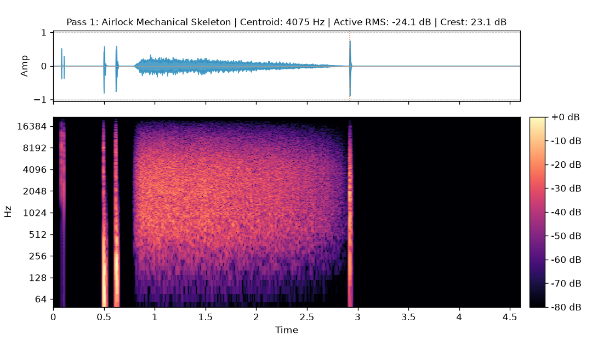
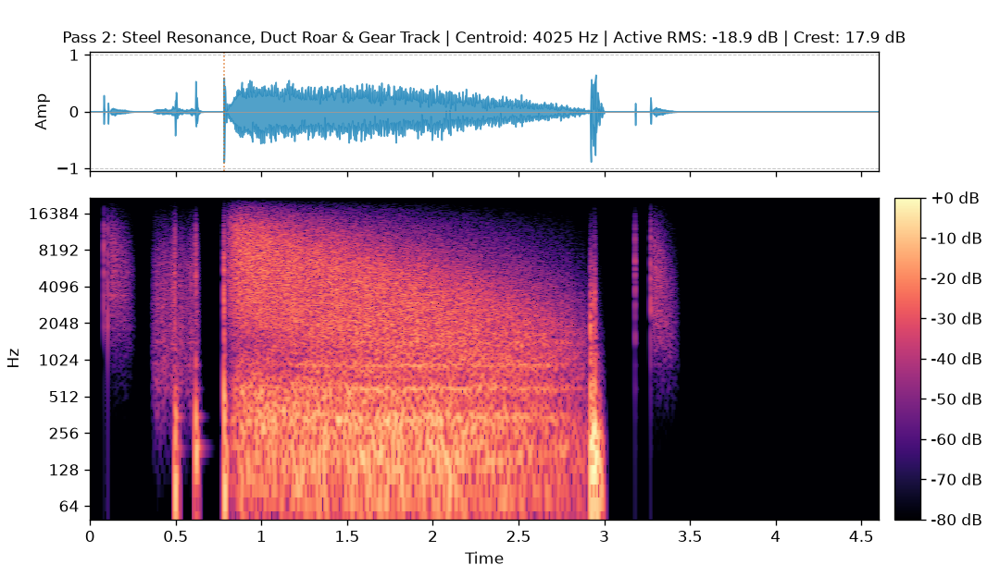
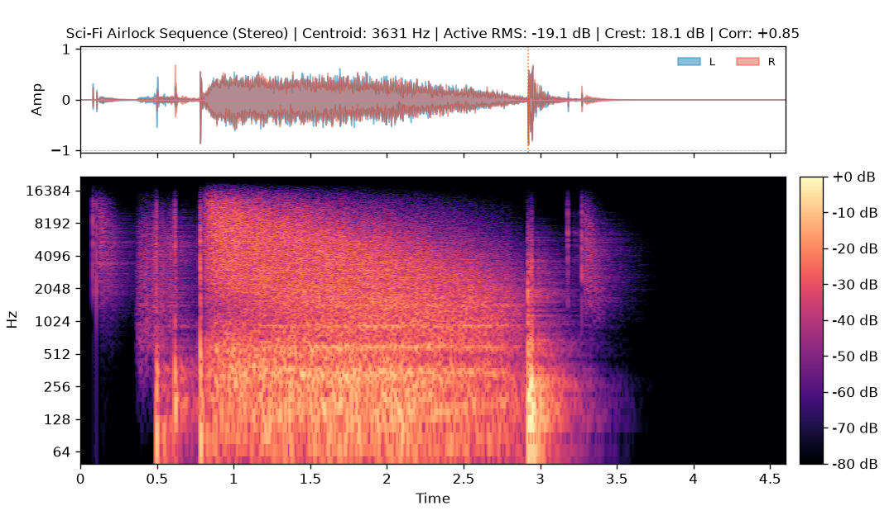
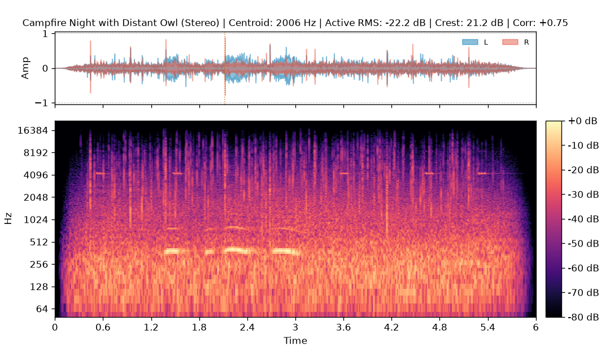
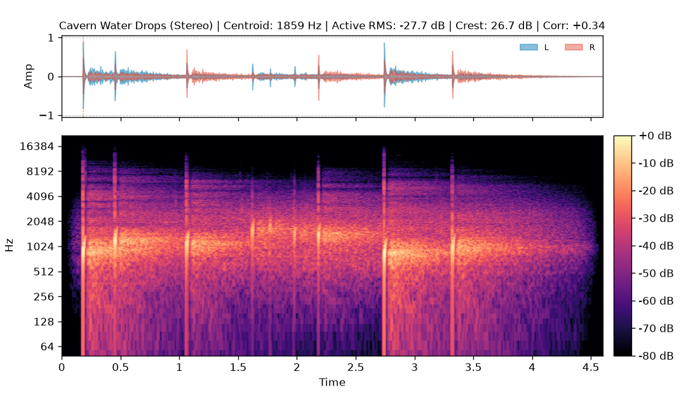
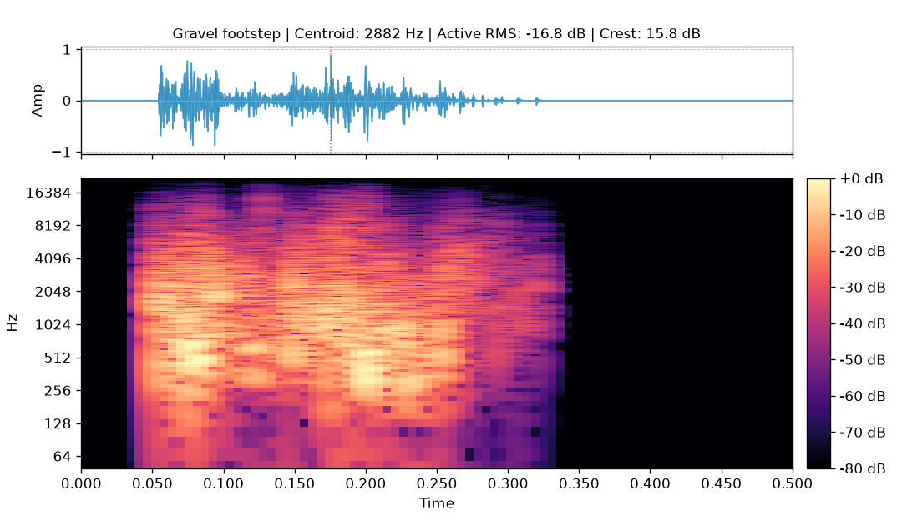
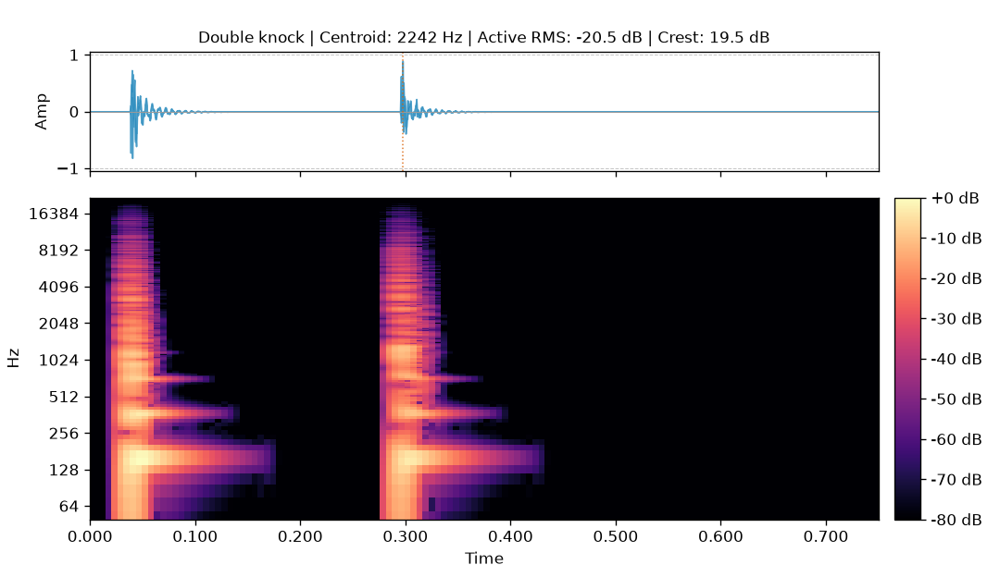
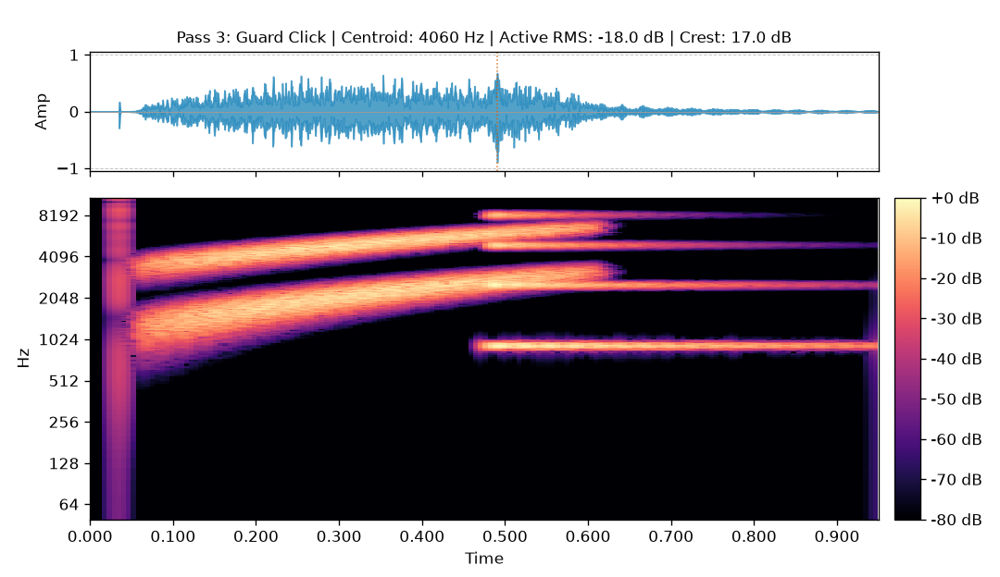

# AudioShmaudio

`audio-shmaudio` ([`skills/audio-shmaudio/`](skills/audio-shmaudio/)) is a portable Agent Skill that equips any AI agent to design, synthesize, inspect, and iteratively refine original sound effects, vocalizations, and layered stereo audio scenes locally in Python—with no generative audio model or external API required.

Instead of synthesizing blindly in one shot, the skill gives an agent a closed-loop workflow: it writes sample-accurate synthesis scripts, renders mono or stereo WAVs alongside dual waveform + log-spectrogram PNGs and structured JSON diagnostics, inspects what it generated, and refines the sound across passes.

## Use with any AI agent

### 1. Install local Python dependencies

Ensure the environment where your agent runs commands has Python 3.9+ and the synthesis dependencies installed:

```bash
python -m venv .venv
source .venv/bin/activate
pip install -r requirements.txt
```

Make `ffmpeg` available on `PATH` (optional) if you want the agent to stitch multi-pass renders into progression MP4 videos.

### 2. Add the skill to your agent

`audio-shmaudio` follows the open `SKILL.md` skill convention and works with any AI agent that supports skill directories or can follow local Markdown instructions and execute Python scripts:

- **Copy the skill folder:** copy `skills/audio-shmaudio/` into your agent's project-level or user-level skills directory, **or**
- **Reference it in place:** point your agent directly at [`skills/audio-shmaudio/SKILL.md`](skills/audio-shmaudio/SKILL.md) inside this repository.

Agents with vision or audio inspection can read the rendered feedback spectrogram PNGs and listen to WAVs directly; text-only agents can still iterate effectively using the returned JSON diagnostics (`weighted_centroid_hz`, `active_rms_db`, `crest_factor_db`, `band_energy_pct`, `tail_rms_db`, `stereo_correlation`) and `cli.py compare`.

### 3. Example prompts to ask your agent

- *"Use `audio-shmaudio` to synthesize a double knuckle knock on a hollow wooden door, inspect the spectrogram, and refine the panel resonance across two passes."*
- *"Create a crisp 0.5 s gravel footstep (`PCM_24`) with a heel strike, rolling weight shift, and loose debris release, and export a progression MP4."*
- *"Build a 6-second stereo campfire night scene with layered ember crackles, a distant owl hoot, and far-right crickets; verify stereo correlation and tail decay."*
- *"Design a 4.6-second stereo sci-fi airlock depressurization and heavy compression-seal sequence using metallic body resonance and geared mechanics—no arcade beeps."*
- *"Analyze `path/to/reference.wav` with the skill CLI, synthesize an original variation from scratch, and measure the spectral shift with `cli.py compare`."*

## How an agent iterates with the skill

1. **Plan** timing, physical behavior (impacts, pressure curves, resonant modes, vocal contours), listening perspective, and room tail.
2. **Synthesize** from direct waveform primitives (`contact`, `granular`, `friction`, `stick_slip`, `tonal`, `vocalize`, `resonate`), stereo spatialization (`StereoScene`), and optional spectral brushes (`paint_oval`, `paint_cloud`, `erase_region`).
3. **Inspect & refine** using the rendered WAV, dual waveform + log-spectrogram PNG, JSON diagnostics, and `cli.py compare` across passes (`canvas.reset()` preserves progression history).
4. **Deliver** the final WAV (`PCM_16` or `PCM_24`), feedback spectrogram, a brief revision summary, and an optional progression MP4.

## Examples of skill output

All examples below were generated locally using the `audio-shmaudio` engine and saved with their exact rendered WAVs, spectrograms, diagnostics, and pass-by-pass progression MP4s.

### Iterative refinement walkthrough — Sci-Fi Airlock Sequence (4.6 s, 24-bit Stereo)

This walkthrough shows how an agent constructs a complex multi-stage sound over three passes, validating timing first, adding physical body resonance and mechanical motion second, and mastering into stereo space last.

| Pass 1: Mechanical Timing Skeleton (Mono) | Pass 2: Steel Resonance, Duct Roar & Gear Track (Mono) |
| --- | --- |
|  |  |
| Relay clicks, dry bolt hits, single vent hiss, and compression impact. **Centroid:** `4075 Hz` · **Active RMS:** `-24.1 dB` · **Crest:** `23.1 dB` · **180–800 Hz:** `16.5%` | Adds `STEEL_MODES` body `resonate`, turbulent duct roar, geared `stick_slip` bulkhead track, spectral chamber wash, and lock clamps. **Centroid:** `4025 Hz` · **Active RMS:** `-18.9 dB` · **Crest:** `17.9 dB` · **180–800 Hz:** `34.4%` |

#### Pass 3: Final Stereo Master



Places layers across the stereo field (`mechanism` pans `-0.50 → +0.50` as the bulkhead travels), adds air absorption (`distance`), applies corridor room reflections, soft-limits peaks (`-1.0 dB` ceiling), and exports 24-bit stereo WAV. **Centroid:** `3631 Hz` · **Active RMS:** `-19.1 dB` · **Crest:** `18.1 dB` · **180–800 Hz:** `35.4%` · **Stereo Corr:** `+0.85` · **Tail RMS:** `-240.0 dB`

[Final WAV (`sci_fi_airlock.wav`)](docs/examples/sci_fi_airlock/sci_fi_airlock.wav) · [Progression Video (`sci_fi_airlock_progression.mp4`)](docs/examples/sci_fi_airlock/sci_fi_airlock_progression.mp4) · [Source Script (`examples/sci_fi_airlock.py`)](examples/sci_fi_airlock.py)

<details>
<summary>Sample diagnostics JSON returned to the agent (final pass)</summary>

```json
{
  "wav_path": "docs/examples/sci_fi_airlock/sci_fi_airlock.wav",
  "spec_path": "docs/examples/sci_fi_airlock/sci_fi_airlock_spec.png",
  "duration_sec": 4.6,
  "channels": 2,
  "peak_db": -1.0,
  "peak_time_sec": 2.9211,
  "rms_db": -20.63,
  "active_rms_db": -19.11,
  "crest_factor_db": 18.11,
  "dc_offset": -1.4e-05,
  "active_start_sec": 0.08,
  "active_end_sec": 3.44,
  "tail_rms_db": -240.0,
  "spectral_centroid_hz": 3505.5,
  "weighted_centroid_hz": 3631.0,
  "energy_below_180_hz_pct": 17.96,
  "band_energy_pct": {
    "below_180_hz": 17.96,
    "180_800_hz": 35.38,
    "800_2500_hz": 16.33,
    "2500_7000_hz": 23.06,
    "above_7000_hz": 7.26
  },
  "clipped": false,
  "mono_rms_db": -20.97,
  "stereo_correlation": 0.849
}
```

</details>

### Output gallery

| Example | Format & Duration | Techniques Demonstrated | Key Metrics | Outputs & Source |
| --- | --- | --- | --- | --- |
| **Sci-Fi Airlock** | Stereo 44.1 kHz · `4.6 s` | Relays, `resonate`, sweeping `friction`, `stick_slip`, spectral wash, `StereoScene` | Centroid `3631 Hz` · Active RMS `-19.1 dB` · Corr `+0.85` | [WAV](docs/examples/sci_fi_airlock/sci_fi_airlock.wav) · [MP4](docs/examples/sci_fi_airlock/sci_fi_airlock_progression.mp4) · [Script](examples/sci_fi_airlock.py) |
| **Campfire Night** | Stereo 44.1 kHz · `6.0 s` | Ember `friction`, asymmetric `granular` crackles, sap `contact`s, `vocalize` owl hoots, `tonal` crickets | Centroid `2006 Hz` · Active RMS `-22.2 dB` · Corr `+0.75` | [WAV](docs/examples/campfire_night/campfire_night.wav) · [MP4](docs/examples/campfire_night/campfire_night_progression.mp4) · [Script](examples/campfire_night.py) |
| **Cavern Water Drops** | Stereo 44.1 kHz · `4.6 s` | Pitch-gliding Minnaert bubble modes, micro-splash grains, distance air absorption, cavern reverb | Centroid `1859 Hz` · Active RMS `-27.7 dB` · Corr `+0.34` | [WAV](docs/examples/cavern_water_drops/cavern_water_drops.wav) · [MP4](docs/examples/cavern_water_drops/cavern_water_drops_progression.mp4) · [Script](examples/cavern_water_drops.py) |
| **Gravel Footstep** | Mono 44.1 kHz · `0.5 s` | Heel/forefoot `contact`, sweeping `friction`, dual-population `granular` crunch & release | Centroid `2882 Hz` · Active RMS `-16.8 dB` · Crest `15.8 dB` | [WAV](docs/examples/gravel_footstep/gravel_footstep.wav) · [MP4](docs/examples/gravel_footstep/gravel_progression.mp4) · [Script](examples/gravel_footstep.py) |
| **Wood Knock** | Mono 44.1 kHz · `0.75 s` | Double knuckle `contact` strikes, uneven wood-panel resonant modes, subtle rebound | Centroid `2242 Hz` · Active RMS `-20.5 dB` · Crest `19.5 dB` | [WAV](docs/examples/wood_knock/wood_knock.wav) · [MP4](docs/examples/wood_knock/wood_knock_progression.mp4) · [Script](examples/wood_knock.py) |
| **Sword Unsheath** | Mono 22.05 kHz · `0.95 s` | Hybrid spectral brushes (`add_formant_noise`, `add_modal_strike`) + time-domain guard click | Centroid `4060 Hz` · Active RMS `-18.0 dB` · Crest `17.0 dB` | [WAV](docs/examples/sword_unsheath/sword_unsheath.wav) · [MP4](docs/examples/sword_unsheath/sword_unsheath_progression.mp4) · [Script](examples/sword_unsheath.py) |

#### Stereo Scenes

| Campfire Night with Distant Owl | Cavern Water Drops |
| --- | --- |
|  |  |

#### Mono Foley & Spectral Brushes

| Gravel Footstep | Wood Knock | Sword Unsheath |
| --- | --- | --- |
|  |  |  |

## What's inside the skill

```text
skills/audio-shmaudio/
├── SKILL.md                         # Core agent instructions & synthesis workflow
├── references/
│   ├── acoustic_recipes.md          # Primitive API & material starting recipes
│   ├── voices_and_scenes.md         # Vocalize formant synthesis & StereoScene mixing
│   └── critique_checklist.md        # Diagnostic-driven edits for common issues
└── scripts/
    ├── spectral_foley.py            # SpectralCanvas, spectral brushes, render & diagnostics
    ├── procedural.py                # Direct waveform primitives & modal_filter
    ├── spatial.py                   # StereoScene, panning, distance absorption, room & limiter
    └── cli.py                       # Inspect, compare, and stitch WAV/PNG passes
```

- **Direct waveform primitives** ([`procedural.py`](skills/audio-shmaudio/scripts/procedural.py)): colored impacts with optional pitch-gliding modes (`contact`), pressure-driven micro-events (`granular`), sweeping continuous surface motion (`friction`), physical stick–slip gear/catch rattle (`stick_slip`), stationary modal object body filtering (`resonate` / `modal_filter`), sustained/swept resonators (`tonal`), and sweeping formant calls (`vocalize`).
- **Spatial & room scene tools** ([`spatial.py`](skills/audio-shmaudio/scripts/spatial.py)): `StereoScene`, `pan_mono`, `distance_filter`, `add_room`, and `soft_limit` place independent layers across stereo panning trajectories, distance air absorption, and decorrelated early reflections + diffuse room tails.
- **Spectral brushes** ([`spectral_foley.py`](skills/audio-shmaudio/scripts/spectral_foley.py)): paint broad noise beds, sweeps, and tonal envelopes; Griffin–Lim reconstruction runs only when spectral paint is non-zero, then mixes cleanly with waveform layers.
- **Feedback, diagnostics & references**: render mono or stereo WAVs (`PCM_16`, `PCM_24`, `FLOAT`) alongside dual waveform + log-spectrogram PNGs and JSON metrics, guided by the [primitive API and material recipes](skills/audio-shmaudio/references/acoustic_recipes.md), [voices and scenes guide](skills/audio-shmaudio/references/voices_and_scenes.md), and [critique checklist](skills/audio-shmaudio/references/critique_checklist.md).

## Running examples, CLI, and tests directly

Regenerate any of the showcase renders locally into `output/`:

```bash
python examples/gravel_footstep.py
python examples/wood_knock.py
python examples/sword_unsheath.py
python examples/cavern_water_drops.py
python examples/campfire_night.py
python examples/sci_fi_airlock.py
```

Inspect an existing WAV at its native sample rate, compare two passes, or stitch a folder of passes with [the CLI](skills/audio-shmaudio/scripts/cli.py):

```bash
python skills/audio-shmaudio/scripts/cli.py analyze path/to/reference.wav --out ref_spec.png
python skills/audio-shmaudio/scripts/cli.py compare output/sci_fi_airlock/pass_01.wav output/sci_fi_airlock/sci_fi_airlock.wav
python skills/audio-shmaudio/scripts/cli.py stitch output/sci_fi_airlock --out progression.mp4
```

Run the test suite:

```bash
pip install pytest
python -m pytest
```
